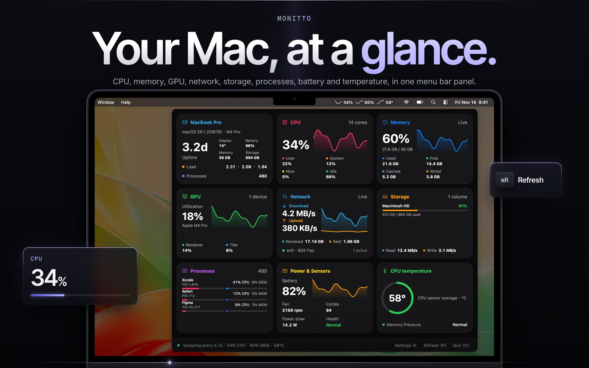

<div align="center">

<a href="https://github.com/Seaony/Monitto/releases/latest"></a>

# Monitto

### 点一下菜单栏，看清这台 Mac 的状态。

**CPU、内存、GPU、网络、存储、进程、电池和温度，都在一个菜单栏面板里。**<br>
最关心的几项可以直接挂在菜单栏上，<br>
哪项超过你设的上限，就发通知提醒你。

  

**[下载](https://github.com/Seaony/Monitto/releases/latest)** &nbsp;·&nbsp; **[发版说明](docs/RELEASING.md)** &nbsp;·&nbsp; [English](README.md) · **简体中文**

<br>



</div>

<br>

## 适合你吗？

Mac 变慢、发烫、风扇响的时候，原因散在好几个地方：CPU 和内存在活动监视器里，电池在系统设置里，温度和风扇转速哪里都看不到。

Monitto 把这些都放进菜单栏图标下的一个面板：

- **一眼看全**：主机、CPU、内存、GPU、网络、存储、进程，以及电池、温度、风扇转速和功耗，每项一张带实时图表的卡片，鼠标停在图表上能看到具体数值。
- **自己排**：卡片可以拖动排序、调整大小，不看的可以关掉。
- **挂在菜单栏上**：从 CPU、内存、网络、磁盘、电池、温度里任选几项，显示成数值、小图表或两者都显示。
- **超限提醒**：给 CPU 负载、内存、磁盘空间和 CPU 温度设上限，超过时发通知，也可以带提示音。

如果你想知道 Mac 在忙什么，又不想开好几个 App，它适合你。活动监视器已经够用的话，就不需要它。

## 快速开始

**1 · 安装。** 从 **[最新版本](https://github.com/Seaony/Monitto/releases/latest)** 下载 DMG，打开后把 `Monitto.app` 拖进「应用程序」。

<sub>安装包同时支持 Apple 芯片和 Intel 芯片，需要 macOS 15 或更新版本。Monitto 通过 Sparkle 从 GitHub Releases 自动更新。</sub>

**2 · 打开面板。** 点菜单栏里的 Monitto 图标。鼠标停在图表或数值上能看到它的含义，按 **⌘R** 立即刷新。

**3 · 按需设置。** 点面板底部的 **设置 ⌘,**，选外观和语言、菜单栏项目、提醒上限和首页显示哪些卡片。

## 功能

### 待在菜单栏里

默认不显示 Dock 图标，需要时可以打开。面板从菜单栏图标下弹出，可以整体缩放。支持浅色和深色外观、英文和简体中文、登录时启动和应用内更新。

### 不费电

所有卡片共用一次采样，每 0.3 到 5 秒采一次。开销大的采样在面板关闭时降频或暂停。

### 数据从哪来

大部分数据来自 macOS 的公开接口。温度、风扇转速和功耗来自 Apple 没有公开说明的传感器，部分 Mac 上可能读不到。每个数字的来源见 [数据源审计清单](docs/DATA_SOURCE_AUDIT.md)。

## 隐私

- 所有数据都在本机读取，不会上传。Monitto 不需要账号，也没有统计。
- 只有检查更新时会联网，访问 Monitto 的 GitHub Releases；检查失败也不影响监控。
- 设置存在 macOS 的偏好设置里。Monitto 写入的文件只有你自己导出的诊断报告。

## 从源码构建

需要 Xcode 26.6。

```sh
git clone https://github.com/Seaony/Monitto.git
cd Monitto
xcodebuild -project Monitto.xcodeproj -scheme Monitto -configuration Debug \
  -derivedDataPath "$PWD/DerivedData" build
open DerivedData/Build/Products/Debug/Monitto.app
```

发版流程见 [发版说明](docs/RELEASING.md)。

## 致谢

自动更新用的是 [Sparkle](https://sparkle-project.org/)。

---

<div align="center">
  <sub>Mac 现在怎么样，点一下就知道。</sub>
</div>
